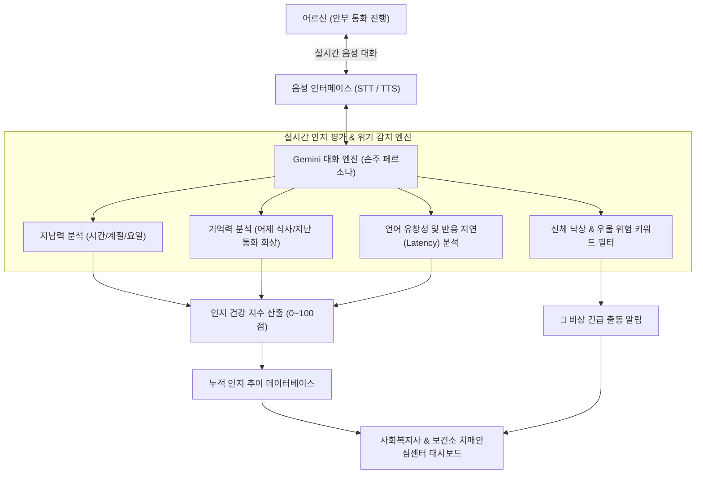

# 온콜 AI (溫-Call AI) 📞🧠👵

> **"외로움은 덜고, 기억은 지킨다 — 어르신 일상 안부 통화와 대화형 인지능력(치매 조기 선별) 평가 시스템"**  
> 2026 전국 청소년 AI 경진대회 출품작 (중등부 · 사회문제 해결 부문)  
> 개발자: 인천현송중학교 1학년 박지찬 (학부모 지도)

[](LICENSE)
[]()
[]()

---

## 📌 1. 프로젝트 개요 (Overview)

대한민국 독거노인 200만 시대, 사회적 고립은 우울증뿐만 아니라 **급격한 인지 기능 저하(치매)**로 이어집니다.  
치매는 조기 발견이 결정적이지만, 어르신들은 보건소의 정식 치매 검사(MMSE)에 대해 **"내가 미쳤냐", "치매 판정받을까 무섭다"며 심한 거부감**을 보입니다.

**`온콜 (溫-Call) AI`**는 일상적인 안부 수다 속에 **비침해적 인지능력 스크리닝(Conversational Cognitive Screening)**을 결합했습니다.
1. **24시간 인바운드 안부 전화**: 어르신이 적적하거나 외로울 때 언제든 전화기를 들면 손주처럼 다정하게 전화를 받아 안부를 묻습니다.
2. **비침해적 대화형 인지능력 측정**: 어르신이 검사라는 것을 전혀 눈치채지 못하도록, 날씨·식사·일과를 묻는 자연스러운 수다를 통해 **지남력(시간/날짜), 단기기억, 언어유창성을 실시간 측정**합니다.
3. **치매 조기 경보 대시보드**: 누적 인지 점수를 추적하여 급격한 기억력 저하가 감지되면 관할 치매안심센터와 복지사에게 정밀검사 권고 알림을 전달합니다.

---

## 🏗️ 2. 시스템 아키텍처 (Architecture)



---

## ✨ 3. 핵심 기능 (Key Features)

1. **소프트웨어적 치매 선별 (Zero-Stress Cognitive Assessment)**:
   - **지남력 (Orientation)**: *"오늘이 벌써 10월 마지막 일요일이네요. 어르신, 오늘이 며칠인지 아셔요?"*
   - **단기/일화 기억 (Memory Recall)**: *"어르신, 어제 점심에 드셨던 따뜻한 국 반찬이 뭐였는지 기억나세요?"*
   - **유창성 (Fluency)**: 대화 응답 지연 시간(Latency)과 단어 반복성을 분석하여 경도인지장애(MCI) 징후 감지.
2. **어르신 전용 청각/음성 UX (Slow & Attentive)**:
   - 일반 음성 AI 대비 15% 느린 음성 합성(TTS), 높은 음량, 경청과 맞장구 중심 대화.
3. **복지사 & 치매안심센터 통합 대시보드**:
   - 어르신별 최근 통화 기록, 인지 점수 변화 추이 그래프, 응급(낙상/가슴답답) 신호 즉각 모니터링.

---

## 💻 4. 화면 구성 및 실행 방법

```bash
git clone https://github.com/sunghanpark/warm-call-ai.git
cd warm-call-ai
open index.html
```

* **어르신 안부 전화기 탭**: 큰 전화 버튼, 실시간 음성 인식(STT), 따뜻한 손주 음성 합성(TTS), 심사위원용 빠른 테스트 시나리오 버튼.
* **복지사 & 인지건강 대시보드 탭**: 지남력, 단기기억, 유창성 종합 스코어카드 및 치매안심센터 연계 배너.

---

## 📅 5. 개발 로드맵

- [x] **1단계 (기획)**: K-MMSE 치매 선별 문항을 일상 안부 수다로 치환하는 프롬프트 및 채점 로직 설계
- [x] **2단계 (프로토타입)**: Web Speech 실시간 음성 통화 및 인지 점수 실시간 연동 웹앱 구축
- [ ] **3단계 (알고리즘 고도화)**: Gemini Vision/Audio 멀티모달 API 기반 음성 톤·침묵 시간 정밀 분석
- [ ] **4단계 (사용자 테스트)**: 조부모님 및 지역 어르신 5명 대상 시범 안부 통화 및 만족도 평가
- [ ] **5단계 (본선 전시)**: 서울대 공대 교수진 멘토링 수료 후 현장 전시 부스에서 레트로 전화기 연동 라이브 시연

---

## 📄 6. 라이선스

본 프로젝트는 고령층 복지 및 치매 조기 발견을 위해 MIT 라이선스로 배포됩니다.
