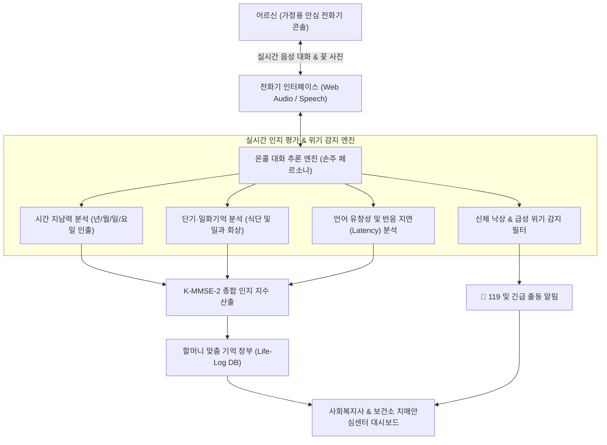

# 온콜 AI (溫-Call AI) 📞👵🌸

> **"손주에게서 먼저 걸려오는 다정한 안부 전화 — 음성 인공지능과 일상 대화를 통한 우리 할머니 치매 조기 지킴이 시스템"**  
> 2026 전국 청소년 AI 경진대회 출품작 (중등부 · 사회문제 해결 부문)  
> 개발자: 인천현송중학교 1학년 박지찬 (학부모 지도)

[](LICENSE)
[]()
[]()

---

## 1. 프로젝트 개요 (Overview)

우리 할머니께서 방 안에서 남몰래 치매를 걱정하시며 눈물 흘리시는 모습을 보았습니다. 가족에게 짐이 될까 미안해서 아무리 외로워도 먼저 전화를 걸지 못하셨고, 치매 환자 취급을 받을까 두려워 보건소 기억력 검사를 피하셨습니다.

**`온콜 (溫-Call) AI`**는 바로 우리 할머니를 향한 손주의 진심에서 출발했습니다.
1. **설정한 시간 먼저 울려오는 손주 전화 (Scheduled Incoming Call)**: 식사·복약 시간에 맞춰 손주 지찬이에게서 전화벨이 먼저 울려옵니다. 어르신은 큼직한 [전화 받기] 버튼 하나로 조작 부담 없이 전화를 받으십니다.
2. **친숙한 목소리와 일상 꽃 사진 공유**: 차가운 기계음 대신 손주의 다정한 음성과 함께 등굣길에 찍은 화사한 꽃 사진을 화면으로 공유하여 심리적 안정감을 드립니다.
3. **대화할수록 깊어지는 맞춤 기억 장부 (Life-Log Engine)**: 매일의 대화 속에서 할머니의 일상 정보(좋아하시는 콩나물국, 베란다 상추 화분, 경로당 친구 등)를 기억하여 진짜 가족 같은 깊은 대화를 나눕니다.
4. **거부감 제로의 일상 대화형 치매 조기 선별**: 손주와의 안부 수다 속에 표준 간이정신상태검사(K-MMSE-2) 문항을 녹여내어, 지남력과 기억력을 일상 속에서 자연스럽게 측정하고 이상 징후 시 복지사 대시보드로 조기 경보를 연계합니다.

---

## 2. 시스템 아키텍처 (Architecture)



---

## 3. 핵심 기능 (Key Features)

1. **가정용 안심 전화기 콘솔 하드웨어 틀 (Hardware Console Frame)**:
   - 좌측 실물 수화기(Handset) 및 나선형 코일 케이블, 상단 정시 자동 발신 바.
   - 중앙 7인치 스마트 스크린과 하단 대형 물리 단축 버튼 3종(1번 손주 직통키, 2번 전담 복지사, 3번 119 긴급출동).
2. **비침해적 대화형 치매 선별 (K-MMSE-2 임상 매핑)**:
   - **지남력 (Orientation)**: *"할머니, 날씨가 쌀쌀해졌는데 오늘이 몇 월 며칠, 무슨 요일인지 아셔요?"*
   - **단기기억 회상 (Memory Recall)**: *"할머니, 어제 점심에 드셨던 따뜻한 국 반찬이 뭐였는지 기억나셔요?"*
   - **유창성 (Fluency)**: 대화 응답 지연 시간(초)과 어휘 다양성을 분석하여 경도인지장애(MCI) 조기 감지.
3. **사회복지사 & 치매안심센터 통합 대시보드**:
   - 관리 어르신 24명의 최근 통화 시각, 인지 점수 추이 그래프, 이상 징후 자동 경보.

---

## 4. 실행 방법

```bash
git clone https://github.com/iscream2124/warm-call-ai.git
cd warm-call-ai
open index.html
```

* **웹 프로토타입**: 스마트폰이나 PC 브라우저에서 `index.html`을 열면 즉시 실제 전화벨과 손주 음성 시뮬레이션 및 K-MMSE-2 실시간 측정을 테스트할 수 있습니다.
* **5초 뒤 자동 수신 테스트**: 상단의 `[⚡ 5초 뒤 자동 수신]`을 누르면 카운트다운 후 실제 전화벨이 울리며 전화가 걸려옵니다.

---

## 5. 개발 로드맵

- [x] **1단계 (기획 & 스토리)**: 할머니의 치매 공포를 해결하기 위한 인커밍 수신 및 K-MMSE-2 일상 대화 매핑 설계
- [x] **2단계 (음성 & 프로토타입)**: 손주 목소리 음원 녹음, 전화기 모양 하드웨어 콘솔 및 실시간 사운드웨이브 캔버스 완성
- [x] **3단계 (안드로이드 패키징)**: 스마트폰에서 실제 전화기처럼 쓰는 네이티브 안드로이드 앱(APK) 및 GitHub Actions 빌드 파이프라인 구축
- [ ] **4단계 (조부모님 파일럿 실증)**: 실제 친할머니 대상 5분 안부 통화 테스트 진행 및 관찰일지 작성 (11월 초)
- [ ] **5단계 (본선 전시 및 시연)**: 서울대 공대 멘토링 수료 후 현장 전시 부스에서 레트로 전화기 연동 라이브 피칭

---

## 6. 라이선스

본 프로젝트는 고령층 복지와 치매 조기 선별을 위해 MIT 라이선스로 배포됩니다.
