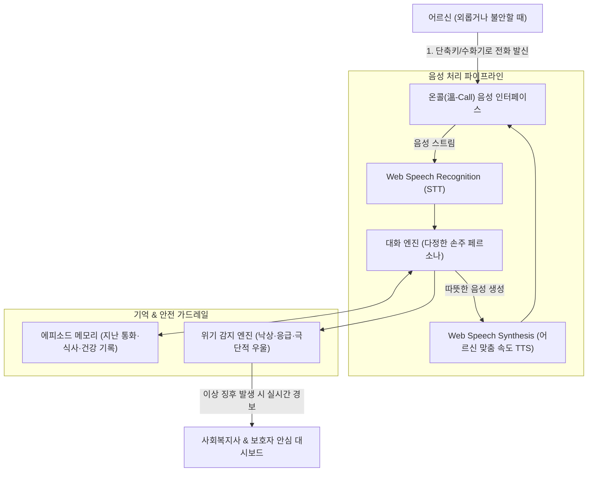

# 온콜 AI (溫-Call AI) 📞👵👴

> **"적적할 땐 언제든 전화 걸렴 — 노년 외로움과 고독사 예방을 위한 24시간 인바운드 말벗 전화"**  
> 2026 전국 청소년 AI 경진대회 출품작 (중등부 · 사회문제 해결 부문)  
> 개발자: 인천현송중학교 1학년 박지찬 (학부모 지도)

[](LICENSE)
[]()
[]()

---

## 📌 1. 프로젝트 개요 (Overview)

대한민국 독거노인 200만 시대, 노년기 우울증과 고독사의 가장 큰 원인은 **"온종일 말 한마디 나눌 상대가 없다"는 극심한 외로움**입니다.

기존 지자체의 '아웃바운드 안부 로봇전화'는 정해진 시간에 기계가 먼저 걸어오기 때문에:
1. 낯선 번호와 기계음에 놀라 **스팸이나 보이스피싱으로 오해하고 끊어버리는 일**이 빈번합니다.
2. 정작 어르신이 극심한 고독과 불안을 느끼는 **새벽, 늦은 밤, 비 오는 날, 주말에는 어디에도 전화를 걸 곳이 없습니다.**
3. 자식이나 손주에게는 "바쁠 텐데 방해될까 봐" 미안해서 먼저 전화를 걸지 못하십니다.

**`온콜 (溫-Call) AI`**는 접근 방식을 완전히 바꾸었습니다.  
**기계가 일방적으로 거는 전화가 아니라, 어르신이 외로울 때 언제든 '먼저 걸면' 다정하게 받아주는 24시간 수신형(Inbound) 손주 말벗 전화**입니다.

---

## 🏗️ 2. 시스템 아키텍처 (Architecture)



---

## ✨ 3. 핵심 기능 (Key Features)

1. **24시간 인바운드 음성 통화 (Zero-Typing)**:
   - 복잡한 앱 화면이나 스마트폰 타자 입력이 전혀 필요 없습니다. 전화기 수화기를 들거나 큰 전화 버튼 하나만 누르면 바로 다정한 손주/이웃 목소리로 연결됩니다.
2. **어르신 맞춤형 페르소나 (Slow & Attentive)**:
   - 어르신의 청력과 반응 속도를 고려하여 일반 AI 대비 **20% 느린 말씨, 높은 음량, 경청과 맞장구 중심**의 대화를 진행합니다.
3. **에피소드 메모리 (Long-term Memory)**:
   - 일회성 대화로 끝나지 않고, 지난 통화 내용을 자연스럽게 기억하여 안부를 묻습니다.  
     *(예: "어르신, 지난번에 무릎 물리치료 다녀오신 건 좀 어떠세요?", "어제 좋아하신다던 나훈아 노래 또 들으셨어요?")*
4. **안전 & 위기 감지 가드레일 (Safety Guardrail)**:
   - 대화 중 *"가슴이 너무 답답하다"*, *"어지러워서 넘어져 있었다"*, *"살아서 뭐하나"* 등 신체 이상이나 위험 표현이 감지되면 복지사 대시보드에 즉시 긴급 알림을 띄웁니다.

---

## 💻 4. 화면 구성 및 라이브 데모

본 프로젝트는 브라우저 상에서 마이크로 실제 대화를 나눌 수 있는 **단독 웹 프로토타입**으로 구현되어 있습니다.

* **모드 1 : 어르신 전용 전화기 화면**:
  - 고대비(High-contrast) 큰 글씨 다이얼 및 원클릭 통화 버튼.
  - 마이크 음성 인식(STT) 및 브라우저 한국어 음성 합성(TTS) 실시간 지원.
* **모드 2 : 사회복지사 안심 모니터링 대시보드**:
  - 어르신별 최근 통화 시간, 통화 주기, 감정 추이(평온/적적함/주의) 요약.
  - 위험 발화 자동 태깅 및 비상 연락망 연동.

```bash
# 실행 방법
git clone https://github.com/sunghanpark/warm-call-ai.git
cd warm-call-ai
open index.html
```

---

## 📅 5. 개발 로드맵

- [x] **1단계 (사회문제 정의 및 기획)**: 독거노인 고독사 통계 분석, 기존 아웃바운드 로봇전화의 한계 규명 및 인바운드 발상 전환
- [x] **2단계 (음성 프로토타입 구축)**: Web Speech API 기반 실시간 양방향 음성 통화 UI 및 에피소드 메모리 시뮬레이션
- [ ] **3단계 (Gemini 음성 파이프라인 연동)**: 초저지연 오디오 스트리밍 및 위기 감지 가드레일 고도화
- [ ] **4단계 (현장 검증)**: 조부모님 및 지역 복지관 어르신 5명 대상 파일럿 통화 및 만족도 조사
- [ ] **5단계 (본선 전시)**: 서울대 공대 교수진 멘토링 반영 및 레트로 전화기 하드웨어 연동 시연

---

## 📄 6. 라이선스

본 프로젝트는 소외 계층의 복지 증진을 위해 MIT 라이선스로 자유롭게 연구·배포할 수 있습니다.
